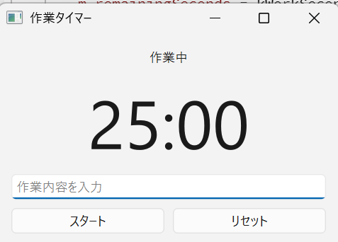

# focus_timer

作業25分と休憩5分を自動で繰り返す、ポモドーロ・テクニック向けの作業タイマーです。
作業内容と時間を記録して、あとから振り返ることができます。
C++ と Qt Widgets で作成した Windows 向けデスクトップアプリです。



## 主な機能

- 25分からのカウントダウン表示（`MM:SS` 形式）
- 作業25分／休憩5分の自動切り替えと、現在のモード（作業中／休憩中）の表示
- モード切り替え時の通知音
- スタート／一時停止／再開、リセット
- 作業内容の入力と、作業終了ごとの作業記録の自動保存（CSV形式）

## 使い方

1. 入力欄に作業内容を入力して「スタート」を押す
2. 25分経つと通知音が鳴り、自動で休憩5分に切り替わる
3. 休憩が終わると、再び作業25分が始まる
4. 「リセット」で作業モード・25:00 に戻る

作業内容は、作業時間が終わった時点で入力欄に入っている内容が記録されます。

## 作業記録

作業が1回終わるごとに、次の場所の CSV ファイルに1行追記されます。

```
%APPDATA%\focus_timer\work_log.csv
```

エクスプローラーのアドレス欄に上のパスを入力すると開けます。Excel でも文字化けせずに開けます。

```
日時,作業内容,作業時間(分)
2026-10-30 14:30,C++の勉強,25
2026-10-30 15:00,未入力,25
```

## 使用技術

| 項目 | 内容 |
| --- | --- |
| 言語 | C++ |
| GUIフレームワーク | Qt 6.12（Qt Widgets） |
| ビルドシステム | CMake |
| コンパイラ | MinGW 13.1.0 64-bit |
| 開発環境 | Qt Creator / VS Code |
| バージョン管理 | Git / GitHub（GitHub CLI） |
| 対応OS | Windows |

## ビルド方法

### Qt Creator を使う場合

1. Qt 6（MinGW 64-bit）と Qt Creator をインストールする
2. Qt Creator で `CMakeLists.txt` を開く
3. キット「Desktop Qt 6.x MinGW 64-bit」を選択する
4. 実行ボタン（▷）でビルドして起動する

### コマンドラインの場合

Qt と MinGW のパスを環境に合わせて指定してください。

```bash
cmake -S . -B build -G "MinGW Makefiles" -DCMAKE_PREFIX_PATH=C:/Qt/6.12.0/mingw_64
cmake --build build
```

## 設計のポイント

- 画面は `.ui` ファイルを使わず、コードでレイアウトを組み立てています（`QVBoxLayout` / `QHBoxLayout`）
- `QTimer` は1秒ごとの合図を出すだけにして、残り秒数と現在のモードはアプリ側の変数で管理しています
- モードは `enum class` で表し、作業・休憩以外の値が入らないようにしています
- 画面表示の更新は `updateDisplay()` に、記録の保存は `appendWorkLog()` にまとめ、処理の役割を分けています
- ボタン操作とタイマーの処理は、Qt のシグナル／スロットで接続しています
- ウィジェットに親を指定し、Qt の親子関係によるメモリ管理を利用しています
- 記録ファイルは `QStandardPaths` で OS 標準のアプリデータ用フォルダに保存し、実行場所に左右されないようにしています
- 新規作成時に BOM と見出し行を書き込み、Excel で開いたときの文字化けを防いでいます

## 開発の進め方

機能ごとに Issue を作成し、作業用ブランチ → プルリクエスト → マージの流れで開発しています。

## 今後の予定

- [x] 作業25分／休憩5分の自動切り替え
- [x] 作業記録のファイル保存
- [ ] 今日・今週の合計作業時間の表示
- [ ] 時間を変更できる設定画面
- [ ] タスクトレイ常駐と通知
- [ ] ユニットテストと GitHub Actions による自動ビルド

## 作者

[shinchan2525](https://github.com/shinchan2525)